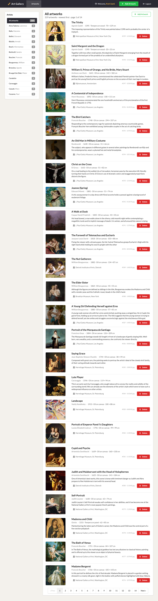

# Task04C, Phuc Tran, Team 43

This README describes the **Task04C-Phuc** branch of the CS 4485 Team 43 Art
Gallery project. It has customer login, an artist list with paging, and add and
delete for artworks, plus the www10 (books) and www13 (login) parts.



## Get this branch

```sh
git clone --branch Task04C-Phuc --single-branch https://github.com/Rafid-A/team43-art-gallery.git
cd team43-art-gallery/Task04C
```

If you already have the repository, run `git fetch` and `git switch Task04C-Phuc`,
then open the `Task04C` folder.

## Run

The short version for XAMPP:

1. Copy `Task04C/artwork`, `Task04C/www10` and `Task04C/www13` into `htdocs`.
2. Start Apache and MySQL in the XAMPP control panel.
3. In phpMyAdmin, import `artwork/art-small.sql`, then `artwork/users.sql`,
   `www10/create-books.sql` and `www13/create-users.sql`.
4. Open http://localhost/artwork/ and log in with `user1` / `pass1`.

Database account setup, all logins and setup without XAMPP are in
[Task04C/README.md](Task04C/README.md).
